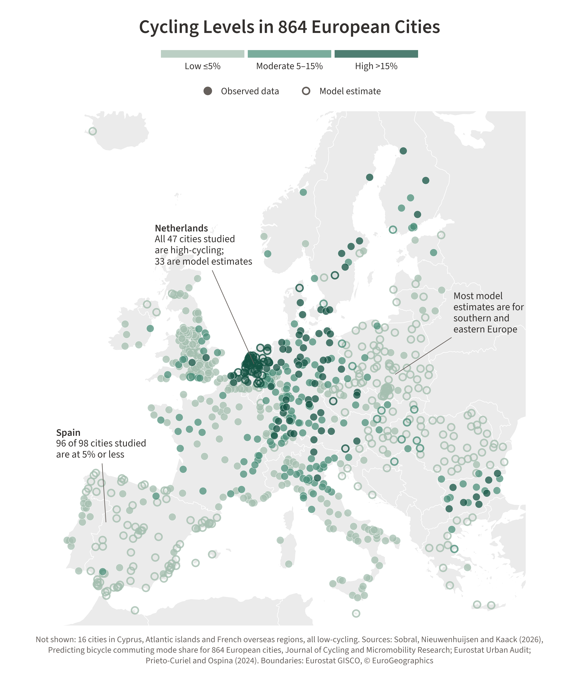

# Cycling mode share in 864 European cities

Data and code for the paper [Predicting bicycle commuting mode share for 864 European cities](https://doi.org/10.1016/j.jcmr.2026.100130).

## Dataset

`cycling_mode_share.csv` has observed and predicted cycling mode share values for 864 European cities.

- `city_code`: city id, for example `AT001C`
- `city`: city name
- `country`: country name
- `predicted`: `True` for predictions, `False` for observed values
- `cycling_mode_share`: observed cycling mode share
- `pred_class`: predicted level: low (0.05 or less), moderate (0.05-0.15), or high (above 0.15)
- `pred_reg`: predicted cycling mode share from the regression
- `prediction_set`: 90% conformal set for `pred_class`

Note: `pred_class` and `pred_reg` are estimated from separate models, so they can differ. Please refer to the paper for a detailed discussion.

<p align="center">
  
</p>

## Code

To reproduce the results, run each of the scripts below in order from the repository root. The scripts require Python 3.12 and the packages in `requirements.txt`.

```
python src/01_features.py         # select features
python src/02_classification.py   # train and compare classifiers
python src/03_shap.py             # compute SHAP values
python src/04_uncertainty.py      # predict levels with conformal sets
python src/05_regression.py       # train the regression model
python src/06_final_dataset.py    # export the dataset
```

## Citation

Sobral, C., Nieuwenhuijsen, M. and Kaack, L. H. (2026). Predicting bicycle commuting mode share for 864 European cities. _Journal of Cycling and Micromobility Research_, 100130.
